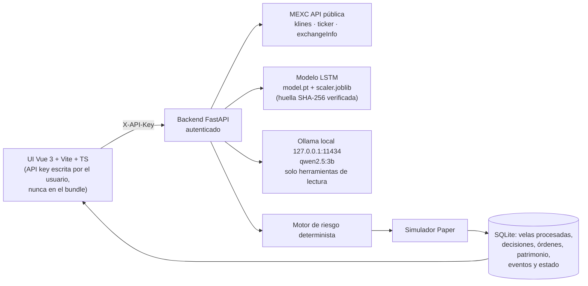

# MEXC Paper Trading Agent · v1.0.1

Agente de trading **en modo Paper (dinero simulado)** para **BTCUSDT** que combina:

- un **modelo predictivo LSTM** (PyTorch) entrenado con datos diarios públicos de MEXC, siguiendo la metodología de la práctica *Deep Learning para Finanzas* (capítulos 7 a 11);
- un **LLM que corre localmente** en la computadora con **Ollama** (`qwen2.5:3b`), que propone `BUY / HOLD / SELL` con una justificación breve;
- un **motor de riesgo determinista** que valida cada propuesta (el LLM nunca lo sustituye);
- un **simulador Paper**, una **UI en Vue 3 + Vite + TypeScript** y un **backend autenticado** en FastAPI.

> ⚠️ **Proyecto académico. No envía órdenes reales.** Solo consume datos **públicos** de MEXC; no existe ninguna ruta de órdenes reales ni se requiere una clave de trading. Nada de esto es asesoría financiera.

**Equipo:** Bruno Ramos · Julio Rangel — **Profesor:** Rubén Miguel Rodríguez Rangel

---

## Versión y tecnologías

| Componente | Tecnología | Versión |
|---|---|---|
| Aplicación | MEXC Paper Trading Agent | **1.0.1** |
| Modelo predictivo | LSTM (PyTorch), artefacto `btcusdt-lstm-1.0.0` **entrenado en NVIDIA Tesla T4 (Google Colab)** | torch 2.14.1+cu130 (entrenamiento) · 2.15.0 (inferencia local) |
| LLM local | Ollama + `qwen2.5:3b` (3.1B parámetros, Q4_K_M, 1.9 GB) | Ollama 0.40.16 |
| Backend | Python + FastAPI + Uvicorn | Python 3.14 · FastAPI 0.163.2 · Uvicorn 0.54.0 |
| Datos y ML | pandas · NumPy · scikit-learn · joblib | 3.1.1 · 2.5.5 · 1.9.1 · 1.6.0 |
| Cliente HTTP / validación | httpx · Pydantic | 0.28.1 · 2.14.3 |
| Persistencia | SQLite (WAL) | incluida en Python |
| UI | **Vue 3 + Vite + TypeScript** | Vue 3.5.45 · Vite 8.3.8 · TypeScript 6.0.3 · vue-tsc 3.3.14 |
| Datos de mercado | MEXC Spot API v3 (endpoints públicos `klines`, `ticker/price`, `exchangeInfo`) | v3 |
| Pruebas | pytest | 9.2.0 |
| Entrenamiento con evidencia de GPU | Google Colab + NVIDIA Tesla T4 (`backend/training/train_colab.ipynb`) | CUDA 13.0 · driver 580.82.07 |

Desarrollado y probado en macOS (Apple M5, 16 GB RAM) con Node 24.

---

## Arquitectura



El LLM **no recibe claves**, no puede modificar límites y no puede saltarse el motor de riesgo. Ollama escucha solo en `127.0.0.1`; el backend actúa como **gateway protegido** con API key (Ollama local no exige autenticación por defecto, por eso esta capa se implementa en el backend).

### Ciclo del agente (protocolo, sección 15)

1. **Velas cerradas de MEXC**: se valida activo, frecuencia (`1d`), orden de fechas, duplicados, precios y antigüedad. La vela en curso **nunca** se usa como definitiva.
2. **Variables** con la misma definición del entrenamiento (`backend/app/features.py`, compartido): 20 rendimientos rezagados → pronóstico LSTM de $y_t = P_{t+1}/P_t - 1$. Indicadores: distancia a SMA20, volatilidad de 20 rendimientos y RSI14.
3. **Ollama** recibe datos estructurados y tres **herramientas de solo lectura** (`obtener_velas_recientes`, `obtener_portafolio`, `obtener_limites_riesgo`). Cualquier otra herramienta se rechaza y se registra.
4. **JSON obligatorio** `{action, symbol, candle_time, justification}` validado con Pydantic: tipos, acción permitida según la posición, símbolo y fecha de vela exactos. Un reintento con esquema estructurado; si vuelve a fallar, la propuesta se rechaza.
5. **Controles de riesgo deterministas** (`backend/app/risk.py`).
6. **Ejecución Paper** y registro en SQLite en **una sola transacción**, con llave única `(corrida, vela)`: la misma vela no se procesa dos veces.
7. La **UI** muestra el resultado; el ciclo programado revisa cada `CYCLE_SECONDS` si cerró una vela nueva.

---

## Instalación y ejecución

Requisitos: Python 3.12+ (probado con 3.14), Node 20+ (probado con 24), [Ollama](https://ollama.com) y Git.

```bash
git clone https://github.com/Julitocrack/mexc-trading-agent.git
cd mexc-trading-agent

# 1) LLM local
brew install ollama            # o el instalador de ollama.com
brew services start ollama     # escucha en 127.0.0.1:11434
ollama pull qwen2.5:3b

# 2) Backend
cd backend
python3 -m venv .venv
.venv/bin/pip install -r requirements.txt
cp .env.example .env
# Generen una clave y pónganla en API_KEY dentro de .env:
python3 -c "import secrets; print(secrets.token_urlsafe(32))"
cd ..
./scripts/run_backend.sh       # http://127.0.0.1:8000  (documentación: /docs)

# 3) UI (otra terminal)
./scripts/run_frontend.sh      # http://127.0.0.1:5173
```

Abran `http://127.0.0.1:5173`, escriban la API key de `backend/.env` y usen **Iniciar / Pausar / Detener**, **Ejecutar ciclo ahora**, **Liquidar posición**, el panel de **replay** y el de **límites de riesgo**.

### Reentrenar el modelo

```bash
cd backend
.venv/bin/python -m training.train            # descarga BTCUSDT 1d de MEXC, entrena y versiona en models/
```

Para la **evidencia de T4** ejecuten `backend/training/train_colab.ipynb` en Google Colab con GPU T4 (usa `--require-t4` y se detiene si no hay T4).

### Pruebas automatizadas

```bash
cd backend && .venv/bin/python -m pytest -v    # 27 pruebas
```

### Evaluación (sin LLM vs con LLM vs comprar y mantener)

```bash
backend/.venv/bin/python scripts/evaluate.py   # replay de todo el periodo de prueba (TE); ≈ 4 s por vela con el LLM
```

---

## Configuración

| Variable (`backend/.env`) | Uso |
|---|---|
| `API_KEY` | Clave del backend (mínimo 16 caracteres). **Sin ella el servidor no arranca.** |
| `SYMBOL`, `INTERVAL` | `BTCUSDT`, `1d` |
| `OLLAMA_URL`, `OLLAMA_MODEL`, `OLLAMA_TIMEOUT` | LLM local (`http://127.0.0.1:11434`, `qwen2.5:3b`) |
| `CYCLE_SECONDS` | Cada cuántos segundos se revisa si cerró una vela nueva (300) |
| `DB_PATH`, `MODEL_DIR`, `RISK_CONFIG` | Rutas de SQLite, artefactos del modelo y límites de riesgo |

`backend/.env` y `backend/config/risk.json` están en `.gitignore`. El repositorio solo incluye `.env.example`, sin valores reales.

### Límites de riesgo (definidos antes de la prueba; el LLM no puede cambiarlos)

| Límite | Valor por defecto |
|---|---|
| Capital inicial | 50,000 USDT |
| Comisión por compra o venta | 0.0% |
| Deslizamiento supuesto | 5 pb (0.05%) en contra |
| Exposición máxima | 95% del patrimonio (sin apalancamiento) |
| Pérdida diaria máxima | 5% respecto de la valoración anterior → estado `HALTED` |
| Antigüedad máxima del dato | 30 h desde el cierre de la última vela |
| Orden mínima | 5 USDT; cantidades redondeadas a 0.000001 BTC (`baseSizePrecision` de MEXC) |
| Umbral δ del modelo | 0.10% (elegido en validación) |

Reglas adicionales: sin ventas en corto, sin compras mayores al efectivo, **Detener** bloquea nuevas órdenes y **no** liquida (liquidar es una acción explícita), y no se cambian límites con el agente en ejecución.

**Supuestos del simulador:** en vivo, la ejecución es al último precio del ticker después del cierre de la vela; en replay, a la **apertura de la vela siguiente**, para no adjudicar ganancias que todavía no podían obtenerse. Se aplica el deslizamiento y la comisión configurados.

---

## API del backend

Todas las rutas, salvo `/api/health`, exigen la cabecera `X-API-Key`; sin ella o con una clave incorrecta responden **401** y el intento queda en la bitácora.

| Método | Ruta | Descripción |
|---|---|---|
| GET | `/api/health` | Versión y estado (pública, sin datos sensibles) |
| GET | `/api/status` | Activo, fecha de datos, pronóstico, indicadores, última decisión, posición, patrimonio y riesgo |
| POST | `/api/agent/start` · `pause` · `stop` | Control humano del ciclo |
| POST | `/api/agent/cycle` | Ejecuta un ciclo ahora |
| POST | `/api/agent/liquidate` | Liquidación explícita de la posición (Paper) |
| GET | `/api/decisions` · `orders` · `equity` · `events` | Registros (`?run_id=` para replays) |
| GET/PUT | `/api/config/risk` | Límites de riesgo (PUT solo con el agente detenido o en pausa) |
| GET | `/api/llm/health` | Modelo, versión, digest, hardware y si la inferencia es local |
| POST | `/api/llm/ask` | Consulta directa al LLM local a través del gateway |
| POST | `/api/replay` | Replay histórico con las 3 estrategias |
| GET | `/api/runs` · `/api/model` | Métricas por corrida y ficha del modelo |

---

## Modelo predictivo

Metodología de la práctica adaptada de AAPL a **BTCUSDT** (protocolo, sección 14): se reentrenó y validó con datos del nuevo activo; no se reutilizaron pesos ni escalas.

- **Datos:** 3,240 velas diarias cerradas de MEXC (2018-01-01 → 2026-11-16), CSV original con huella SHA-256 en la ficha. Auditoría: 0 duplicados, 2 días sin vela en 2019 (no se rellenan), 234 velas antiguas con apertura distinta de 00:00 UTC (documentadas).
- **Objetivo:** $y_t = P_{t+1}/P_t - 1$; entradas: 20 rendimientos rezagados. Escalador ajustado **solo con TR**.
- **Particiones por fecha objetivo:** TR 2,253 (2018-01 → 2024-03) · VA 483 (2024-03 → 2025-07) · TE 483 (2025-07 → 2026-11).
- **Entrenamiento en GPU T4** (Colab, `--require-t4`): dispositivo `cuda`, `Tesla T4`, semilla 42; la salida de `nvidia-smi` queda guardada en la ficha del modelo.
- **Selección con VA:** LSTM con 16, 32 y 64 neuronas; gana **h = 32** (4,513 parámetros), repetida con 3 semillas (RMSE VA 2.5095% ± 0.0011 pp).

| RMSE | VA | TE (una sola evaluación) |
|---|---|---|
| Pronóstico cero | 2.5119% | 2.2175% |
| Regresión lineal | 2.5070% | 2.2339% |
| **LSTM h=32** | 2.5087% | 2.2282% |

**Interpretación honesta:** igual que en la práctica con AAPL, la LSTM **no supera de forma robusta** al pronóstico cero. Sus predicciones son casi constantes y cercanas al rendimiento medio. En TE queda 0.5% peor que pronosticar cero. El umbral δ = 0.10% se eligió en VA entre cinco candidatos. En el cálculo simple del entrenamiento (sin deslizamiento), la regla δ perdió −39.6% en TE, mientras que comprar y mantener perdió −44.7%, porque BTC cayó en ese periodo.

La ficha completa está en `backend/models/model_card.json`: arquitectura, hiperparámetros, dispositivo (`cuda`, `Tesla T4`), salida de `nvidia-smi`, versiones, auditoría, métricas, candidatos de δ y huellas SHA-256. El backend verifica la huella del modelo y el contrato de variables al cargarlo. El escalador se guardó con scikit-learn 1.6.1 (Colab); al cargarlo con otra versión se comprueba numéricamente que `transform(x) = (x − media) / escala`.

---

## Manejo de errores (nueve escenarios del protocolo)

| Escenario | Respuesta del sistema | Prueba |
|---|---|---|
| API sin respuesta / límite de solicitudes | 3 reintentos con espera creciente (1 s, 2 s; respeta `Retry-After`); si falla, el agente pasa a **PAUSA** y no opera | `test_1_*` |
| Dato atrasado | Rechazo si la última vela cerró hace más de 30 h; **PAUSA** | `test_2_*` |
| Ollama detenido | Reintentos limitados; **PAUSA**; la vela no se marca y se reintenta al reanudar | `test_3_*` |
| JSON inválido | Un reintento con esquema; si falla, la propuesta se rechaza (`HOLD`, sin orden) y el agente pasa a **PAUSA** | `test_4_*` |
| Clave incorrecta | **401** y registro en la bitácora; sin `API_KEY` el servidor no arranca | `test_5_*` |
| Saldo insuficiente | El motor de riesgo y el simulador rechazan la orden; el efectivo nunca queda negativo | `test_6_*` |
| Evento duplicado | Llave única `(corrida, vela)`: la segunda vez no genera decisión ni orden | `test_7_*` |
| Reinicio del backend | Portafolio y velas procesadas se recuperan de SQLite; si estaba en ejecución, vuelve en **PAUSA**; no se duplican operaciones | `test_8_*` |
| Botón de detención | Bloquea nuevas órdenes, conserva y muestra la posición; liquidar es otra acción | `test_9_*` |

La salida de las 27 pruebas está en [`docs/evidencia/pruebas_pytest.txt`](docs/evidencia/pruebas_pytest.txt). La demostración **en vivo** contra el backend real (clave incorrecta, vela duplicada, Ollama detenido y recuperado, botón de detención, límites protegidos y reinicio del backend) está en [`docs/evidencia/demo_errores_en_vivo.txt`](docs/evidencia/demo_errores_en_vivo.txt) y se repite con `scripts/demo_errores.py`. Captura de la UI en un ciclo real: [`docs/evidencia/ui_ciclo_en_vivo.jpg`](docs/evidencia/ui_ciclo_en_vivo.jpg). Los datos externos se tratan como datos y nunca como instrucciones: el prompt lo indica y la validación rechaza cualquier acción, símbolo o fecha fuera de lo permitido.

---

## Evaluación

**Replay** con velas históricas de MEXC, identificado como tal y separado del modo en vivo, sobre el periodo de prueba independiente (TE) del modelo: **2025-07-21 → 2026-11-15, 482 ciclos de decisión por estrategia**. Las tres estrategias usan el mismo periodo, los mismos costos (comisión 0.0% y deslizamiento de 5 pb) y 50,000 USDT iniciales. La decisión se toma al cierre de t, la ejecución es a la apertura de t+1 y al final se liquida al último cierre con costos.

| Estrategia | Rend. neto | Máx. drawdown | Compras / ventas | Win Rate | Costos (USDT) | Acciones rechazadas | Latencia LLM |
|---|---|---|---|---|---|---|---|
| Agente con LLM local (`qwen2.5:3b`) | **−38.45%** | −47.51% | 8 / 8 | 12.5% | 286.71 | 0 | mediana 3.9 s · p95 5.1 s |
| Modelo sin LLM (regla δ = 0.10%) | **−38.45%** | −47.51% | 8 / 8 | 12.5% | 286.71 | 0 | — |
| Comprar y mantener | **−42.55%** | −50.46% | 1 / 0 | no definido (sin operaciones cerradas) | 23.74 | 0 | — |

**Interpretación:**
- Modelo evaluado: el artefacto **entrenado en la T4** (LSTM h=32).
- BTC cayó con fuerza en el periodo de prueba. Las estrategias activas perdieron menos que comprar y mantener (−38.5% contra −42.6%) y tuvieron un drawdown algo menor (−47.5% contra −50.5%), pero **ninguna tuvo rentabilidad positiva**. Con este modelo, la regla casi siempre estuvo invertida: hizo solo 8 operaciones cerradas y ganó 1 de 8.
- **El LLM no aportó valor medible:** en las 482 velas eligió la misma acción que la regla del modelo (0 diferencias), no usó herramientas y no tuvo propuestas rechazadas. En la práctica actuó como un "traductor" de la señal LSTM, con justificación en lenguaje natural, a cambio de unos 3.9 s de latencia por decisión.
- El protocolo pide evaluar si el LLM aporta valor y no exige que lo mejore. Este resultado indica que, con este modelo predictivo, la ventaja tendría que venir de mejores variables o de un LLM con información adicional, no del LLM por sí solo.

Archivos: [`docs/evaluacion/EVALUACION.md`](docs/evaluacion/EVALUACION.md), `resultados.csv`, y `decisiones_*.csv` / `ordenes_*.csv` por estrategia (cada decisión incluye la justificación del LLM y su latencia).

---

## Recomendaciones

**Para usarlo**
1. **No conecten dinero real.** El proyecto es solo Paper. Antes de cualquier uso real harían falta firmas de órdenes, gestión de claves con permisos mínimos, auditoría de seguridad y una prueba fuera de muestra nueva.
2. **Mantengan el LLM local:** Ollama solo en `127.0.0.1`, sin exponer el puerto 11434 a la red. Todo acceso pasa por el backend con API key.
3. **Roten la `API_KEY`** si se comparte la pantalla o el archivo `.env`, y nunca la pongan en variables `VITE_` ni en el código de la UI.
4. **Reentrenen siempre en Colab con T4** (`train_colab.ipynb`), como se hizo con el artefacto incluido, y reemplacen los archivos de `backend/models/` solo si la ficha y la huella SHA-256 coinciden.
5. **No aceleren la frecuencia** para "ver más ciclos" en vivo: el modelo es diario. Para demostraciones usen el replay, que queda identificado como tal.
6. Revisen la **bitácora de eventos** en la UI después de cada pausa automática antes de reanudar.

**Para mejorar el modelo y el agente**
1. **Mejores variables:** el capítulo 11 sugiere agregar indicadores (distancia a SMA20, volatilidad) como entradas y comparar con VA. Con solo 20 rezagos casi no hay señal aprovechable.
2. **Validación en varias ventanas** (capítulo 9): ventanas expansivas para comprobar que δ no dependa de un único periodo favorable.
3. **Probar un LLM más grande** (`qwen2.5:7b`): mejora las justificaciones a cambio de más latencia. Comparen la tasa de rechazos y la latencia con la misma evaluación.
4. **Siguiente paso del protocolo:** convertir el simulador en un entorno y entrenar DQN/DDQN con una política de referencia, evaluando con datos nuevos.

---

## Limitaciones conocidas

- La LSTM no supera de forma robusta al pronóstico cero (ver sección *Modelo predictivo*); la evaluación lo reporta tal cual.
- Con frecuencia diaria, 20 ciclos en vivo tardan 20 días. Los ciclos de la evaluación son de **replay** y están identificados como tales, separados del modo en vivo.
- Un LLM de 3B parámetros a veces simplifica su justificación. La decisión final siempre pasa por la validación y por el motor de riesgo.

---

## Estructura del repositorio

```
backend/
  app/            config · mexc · features · model · llm · risk · paper · store · agent · main
  training/       train.py (entrenamiento versionado) · train_colab.ipynb (evidencia T4)
  models/         model.pt · scaler.joblib · model_card.json · curvas.csv
  tests/          27 pruebas (errores del protocolo y controles)
  .env.example    configuración sin secretos
frontend/         Vue 3 + Vite + TypeScript (src/App.vue, components/, api.ts)
scripts/          run_backend.sh · run_frontend.sh · evaluate.py
docs/             evaluacion/ (resultados y decisiones) · evidencia/
```

## Historial de versiones

| Versión | Cambios |
|---|---|
| **1.0.1** | Modelo reentrenado en **NVIDIA Tesla T4 (Google Colab)** con `train_colab.ipynb` (LSTM h=32) y CSV de entrenamiento con huella verificada; el escalador se valida numéricamente al cargarse con otra versión de scikit-learn; evaluación de las tres estrategias repetida con el modelo de la T4. |
| 1.0.0 | Primera entrega: backend FastAPI autenticado, LLM local con Ollama, motor de riesgo, simulador Paper, UI Vue 3 + Vite + TypeScript, 27 pruebas y evaluación por replay. |

## Licencia

MIT. Ver [LICENSE](LICENSE).
